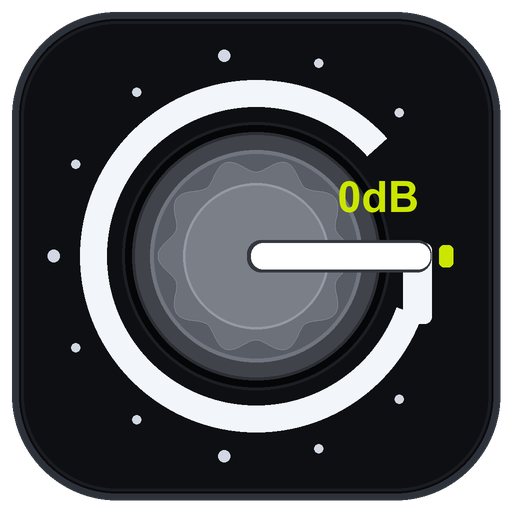
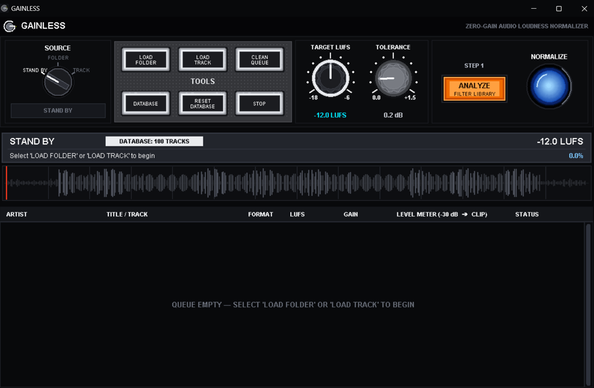
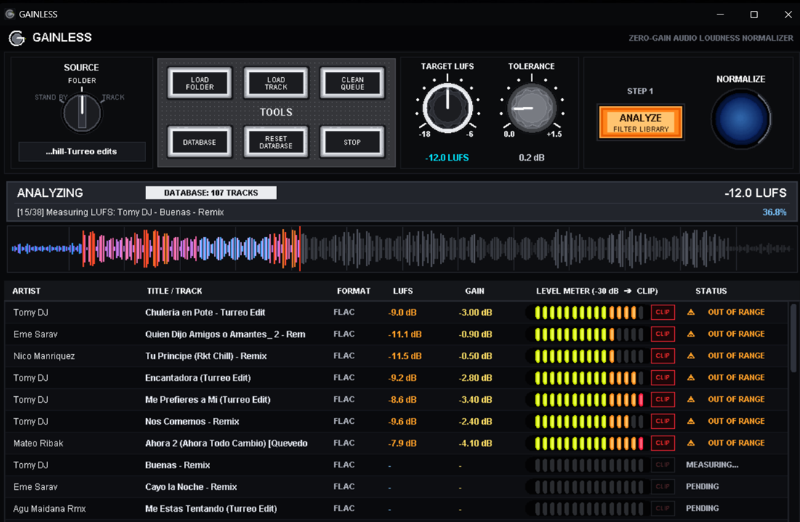

  

<h1 align="center">GAINLESS — Zero-Gain Audio Loudness Normalizer (LUFS)</h1>

  <b>100% Free & Open-Source Loudness Alignment Tool for DJs.</b> 
  <i>100% Gratuito y de Código Abierto — Nivelador de sonoridad LUFS para DJs.</i>

  
    
  

---

## 🇬🇧 English

**GAINLESS** is a desktop application for Windows that analyzes your DJ music library using the **ITU-R BS.1770 (LUFS)** standard and attenuates tracks that exceed your target loudness level—without ever applying destructive limiting or altering your **Rekordbox** analysis data.

### ✨ Key Features
* **Rekordbox & ID3 Safe:** Clones the complete binary metadata tree (`ID3v2.3`, `FLAC Vorbis`, `WAV/AIFF ID3`, `MP4`) and preserves exact original Sample Rates so your **Hot Cues, Memory Cues, Beatgrids, Keys, BPM, and Artwork** remain 100% intact.
* **Pure Attenuation (Zero Dynamic Loss):** Only attenuates tracks that are louder than your target LUFS + tolerance. Tracks already in range are untouched.
* **2-Step Safe Workflow:**
  1. **ANALYZE & FILTER:** Scans folders and subfolders recursively, automatically logging and filtering out tracks that are already within your target range.
  2. **NORMALIZE:** Applies clean gain reduction only to out-of-range tracks.
* **Permanent Smart Database (`AppData`):** Keeps a central history of analyzed tracks in Windows `AppData` (never cluttering your music folders with temporary log files) so you never scan the same track twice.
* **Non-Blocking Multi-Threaded Engine:** Runs smoothly in the background even when minimized, with hardware-inspired horizontal LED level meters and CLIP indicators per track.

### 🚀 Download Releases (No Python Required)
Go to the [**Releases**](../../releases) section and choose the edition that fits your setup:

| Edition | File | Size | Description |
| :--- | :--- | :--- | :--- |
| **Portable / All-in-One (Recommended)** | **`GAINLESS_Portable.exe`** | ~170 MB | **Plug & Play / Zero Setup.** Bundles static `FFmpeg` and `FFprobe` engines inside. Works out of the box on any Windows PC without installing anything. |
| **Standalone / Lightweight** | **`GAINLESS.exe`** | ~13 MB | **Ultra-compact.** For users and DJs who already have `FFmpeg` installed and available in their Windows `PATH`. |

---

## 🇪🇸 Español

**GAINLESS** es una aplicación de escritorio gratuita para Windows que analiza tu biblioteca musical bajo el estándar **ITU-R BS.1770 (LUFS)** y atenúa únicamente las canciones que superan tu nivel objetivo, sin usar limitadores destructivos y manteniendo intacto todo el análisis de **Rekordbox**.

### ✨ Características Principales
* **100% Seguro para Rekordbox y Etiquetas ID3:** Clona todas las etiquetas originales y mantiene la frecuencia de muestreo exacta para que tus **Hot Cues, Memory Cues, Beatgrids (grillas), Tonalidad, BPM y Portadas** no sufran ningún cambio ni desfasaje.
* **Atenuación Pura (Sin pérdida de dinámica):** Solo reduce la ganancia en los temas pasados de volumen. Los temas que ya están en rango no se recodifican.
* **Flujo de Trabajo en 2 Pasos:**
  1. **ANALIZAR Y FILTRAR:** Escanea carpetas y subcarpetas completas, descartando de la tabla y registrando en memoria las canciones que ya están en rango.
  2. **NORMALIZAR:** Aplica el ajuste de ganancia únicamente a las pistas que quedaron fuera de rango.
* **Base de Datos Permanente Limpia (`AppData`):** Recuerda qué canciones ya fueron procesadas guardando el registro en el sistema, sin ensuciar tus carpetas de música con archivos temporales.
* **Vúmetros tipo hardware:** Monitoreo visual de niveles por pista y visualizador de CLIP en tiempo real.

### 🚀 Descarga de Versiones (Sin necesidad de Python)
Entrá a la sección [**Releases**](../../releases) a la derecha y elegí la versión adecuada para tu equipo:

| Versión | Archivo | Tamaño | Descripción |
| :--- | :--- | :--- | :--- |
| **Portable / Todo-en-Uno (Recomendada)** | **`GAINLESS_Portable.exe`** | ~170 MB | **Lista para usar.** Trae `FFmpeg` y `FFprobe` integrados. Funciona directamente en cualquier PC Windows con solo hacer doble clic, sin instalar nada adicional. |
| **Standalone / Liviana** | **`GAINLESS.exe`** | ~13 MB | **Ultra-liviana.** Diseñada para usuarios y DJs que ya cuentan con `FFmpeg` instalado y configurado en el `PATH` de Windows. |
